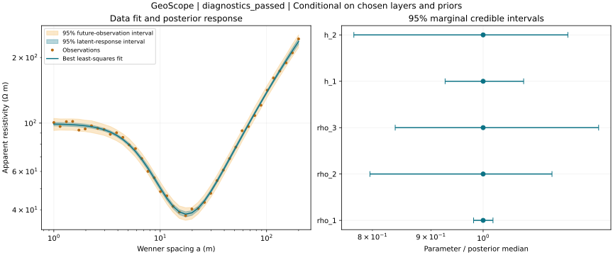
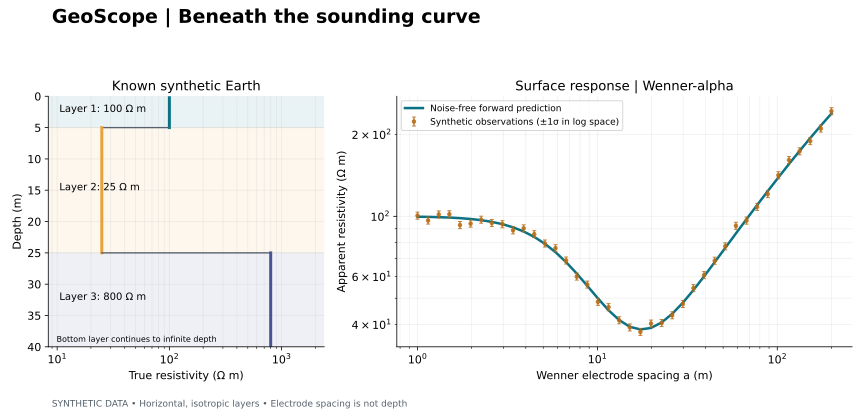

# GeoScope — Resistivity

**How much can electrical measurements tell us about the Earth beneath us?**

GeoScope is a Python project exploring layered-earth electrical resistivity,
inverse problems, and eventually uncertainty. It builds on Gabriel Chiazor
Unomah's physics and groundwater geophysics background at the University of Lagos.

**Current version: v0.2 — complete synthetic workflow.** Simulate a layered Earth,
recover layer properties from multiple starting models, sample the posterior
with four independent chains, compare noise and survey extent, and explore an
interactive Streamlit dashboard. The software is a research demonstration;
field-data validation and a peer-reviewed study remain separate tasks.



## Start here

If you already installed the first version, open Command Prompt in the project
folder and run:

```bat
git pull
.venv\Scripts\python -m pip install -e ".[dev,dashboard]"
.venv\Scripts\python -m streamlit run streamlit_app.py
```

The dashboard opens in your browser, normally at `http://localhost:8501`.
Change layer properties or upload a Wenner-alpha CSV, compare recovered values,
then click **Run uncertainty analysis**. Downloads include data, diagnostics,
and unthinned samples. Results clear when inputs change. This dashboard runs on
your own computer; the GitHub repository is not a hosted web app.

For a fresh Windows installation, follow the steps below. You can also
double-click `launch_dashboard.bat` after installing Python and downloading or
cloning the repository; it creates the environment and installs dependencies.

## Run the complete analysis

After installation:

```bat
.venv\Scripts\python -m geoscope.analysis --sensitivity
.venv\Scripts\python -m pytest -q
```

Linux/macOS: replace `.venv\Scripts\python` with `.venv/bin/python`.

The analysis writes `results/analysis/analysis.json`, a parameter summary,
multiple-start comparison, response intervals, posterior traces, and six
sensitivity experiments. Full samples are saved as `posterior_samples.npz`
locally and excluded from version control. Reproduce every output with the
command above. The defaults use 4 chains, 2,000 warmup iterations, and 4,000
retained draws per chain. Increase `--draws` and `--warmup` for difficult cases;
diagnostic failure is reported as `inconclusive_sampling`, not success.

Analyze your own **Wenner-alpha** CSV:

```bat
.venv\Scripts\python -m geoscope.analysis --data my_sounding.csv --layers 3 --output results/my_analysis
```

Required columns are `a_m`, `rhoa_observed_ohm_m`, and `sigma_log`, all positive
and finite. The last is the standard deviation of log-resistivity errors, not
an uncertainty in Ω m. Arrays must have equal lengths. Do not use Schlumberger
or dipole–dipole data with this Wenner operator. Uploads are not automatically
classified or verified as field data.



## Run it on Windows

Install Python 3.11 or 3.12 and Git first. Open **Command Prompt**, then run each
line in order:

```bat
git clone https://github.com/TheABZ/geoscope-resistivity.git
cd geoscope-resistivity
py -3.11 -m venv .venv
.venv\Scripts\python -m pip install -e ".[dev,dashboard]"
.venv\Scripts\python -m geoscope.demo --config examples/three_layer.json --output results
```

Use `py -3.12` instead if Python 3.12 is installed. Explicit interpreter paths
avoid PowerShell activation-policy issues. In PowerShell, prefix the interpreter
path with `.\` (for example `.\.venv\Scripts\python`).

Expected output:

```text
Simulated 40 Wenner measurements.
Saved figure, CSV, and experiment metadata to ...results
```

Open `results/first_sounding.svg` in a browser. Open the CSV in Excel or Python.
The generated files are:

| File | Contents |
| --- | --- |
| `results/first_sounding.svg` | True layer properties beside the simulated sounding |
| `results/synthetic_sounding.csv` | Spacing, clean response, noisy response, log-space standard deviation |
| `results/experiment.json` | Model, noise assumptions, random seed, software versions |

## Run it on Linux or macOS

```sh
git clone https://github.com/TheABZ/geoscope-resistivity.git
cd geoscope-resistivity
python3 -m venv .venv
.venv/bin/python -m pip install -e '.[dev,dashboard]'
.venv/bin/python -m geoscope.demo --config examples/three_layer.json --output results
.venv/bin/python -m pytest -q
```

After installation, `geoscope --output results` is also available when the virtual
environment is activated. `python -m geoscope.demo` works without activation when
using the environment's Python as above. Python >=3.10 is declared; 3.11/3.12 are
the recommended starting environments. See `requirements-tested.txt` for the
exact dependency versions used for the committed example.

## The experiment

| Layer | Resistivity (Ω m) | Thickness (m) |
| --- | ---: | ---: |
| 1 | 100 | 5 |
| 2 | 25 | 20 |
| 3 | 800 | Infinite half-space |

The survey uses 40 logarithmically spaced Wenner spacings from 1 to 200 m.
All four electrodes lie on a flat surface in the order A–M–N–B, equally spaced
by `a`. The geometric factor is `K = 2πa`; apparent resistivity is
`rho_a = K * ΔV / I`. SimPEG computes the response of the layered medium.

Noise is Gaussian in log space:
`log(rho_observed / rho_clean) ~ Normal(0, sigma_log²)`, with `sigma_log=0.03`
and seed 42. This is about 3% fractional noise for small errors; the noise-free
prediction is the distribution's median. Figure error bars show a one-standard-
deviation multiplicative noise scale around each observation. **They are not
uncertainty intervals for underground layer properties.**

Edit `examples/three_layer.json` to change resistivities, thicknesses, electrode
spacing, or noise. Keep N resistivities and N−1 thicknesses, all positive. Run
with `--output results/my_experiment` to preserve the original example.

## Scientific scope and checks

- Every included measurement is **synthetic**, not an Eruwa field measurement.
- Layers are horizontal, laterally infinite, isotropic, and homogeneous within
  each layer. The surface is flat and electrodes are ideal point electrodes.
- Electrode spacing controls sensitivity; it is not a measurement of depth.
- Low resistivity alone does not identify water. Clay, salinity, lithology, and
  other factors matter. This tool does not estimate borehole yield or recommend
  drilling locations.
- Tests compare the numerical forward solver against a homogeneous half-space
  and an independent analytical two-layer image series, then check invisible
  interfaces, resistivity scaling, noise reproducibility, invalid inputs, and
  the complete export workflow. Additional tests recover a known three-layer
  model, compare the sampler with an analytic one-layer posterior, detect
  deliberately unmixed chains, and exercise dashboard inputs, sampling, and
  clearing stale results.

## Inference assumptions

SciPy least squares minimizes log-space residuals divided by their known
standard deviations. The assumed number of layers stays fixed. Independent
priors are uniform in log resistivity over 10–3000 Ω m and log thickness over
0.5–100 m. This is not a uniform prior in physical units. No smoothing or
extra regularisation is used beyond these bounds.

Four independent random-walk Metropolis chains start dispersed near the best
fit. Covariance adaptation occurs during warmup only. ArviZ checks rank-normalized
split R-hat ≤1.01 and bulk/tail ESS ≥400 for **every** parameter. Passing these
checks does not guarantee exploration of other posterior modes. Intervals remain
conditional on priors, layer count, known noise, and a 1D Earth. They exclude
uncertainty in geology, array geometry, and model class.

The example has weighted residual RMS ≈0.790. Its 30 m survey-extent experiments
hit the deep-resistivity upper bound, while the 200 m experiments constrain it
better in this one synthetic case. A good residual alone does not establish a
reliable layer estimate. See [the example results](docs/results.md).

Windows test command: `.venv\Scripts\python -m pytest -q`.

Validation for this update: **30 tests passed on Python 3.12/Linux**, including
Streamlit AppTest interactions. The Windows launcher is provided but has not
been executed on Windows. A separate Chromium screenshot check was blocked by
this execution environment's process/socket restrictions.

## Development path

- [x] Forward model, synthetic noise, exports, physics benchmarks
- [x] Bounded inversion of resistivity and thickness in log coordinates
- [x] Multiple starting models and survey/noise sensitivity experiments
- [x] Bayesian sampling with explicit priors and convergence diagnostics
- [x] Interactive dashboard with CSV input and downloads
- [ ] Field-data case study after data and metadata review

Read [Lesson 1](docs/lesson_01.md) for an introduction and a small experiment.
Continue with [Lesson 2](docs/lesson_02.md) for inversion and uncertainty.
Read [the methods](docs/methods.md) for numerical assumptions and references.

## Attribution and licence

Project author: **Gabriel Chiazor Unomah**. MIT licence; see [LICENSE](LICENSE).
The forward solver is provided by **SimPEG**, with its own licence and citation
requirements. GeoScope is a learning and research software project, not a claim
of a new inversion algorithm or a peer-reviewed scientific finding.
