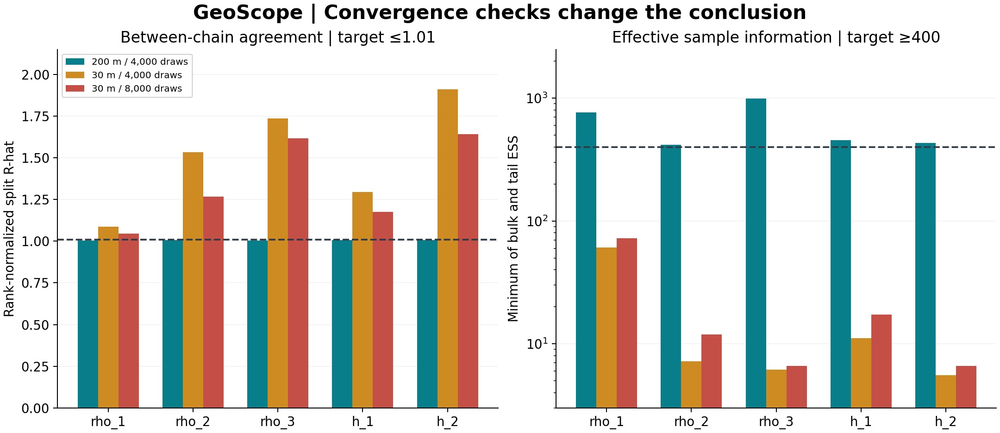
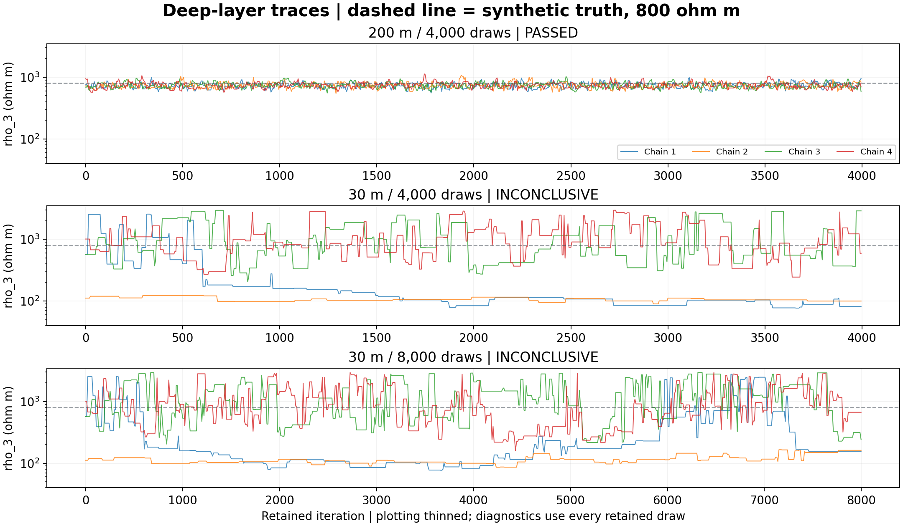

# Verified synthetic results

Three supplied dashboard exports were checked against their raw posterior
samples. The 200 m baseline passed the declared convergence checks; both
30 m exports failed. Survey labels come from the user and screenshots; the
legacy files do not independently encode electrode spacings.

| Survey / retained draws per chain | Maximum R-hat | Minimum bulk ESS | Minimum tail ESS | Decision |
| --- | ---: | ---: | ---: | --- |
| 200 m / 4,000 | 1.0056 | 623.8 | 417.5 | Passed |
| 30 m / 4,000 | 1.9091 | 5.6 | 27.2 | Inconclusive |
| 30 m / 8,000 | 1.6418 | 6.6 | 12.2 | Inconclusive |

Every parameter must have rank-normalized split R-hat ≤1.01 and bulk/tail ESS
≥400. All runs have four chains, seed 43, and 2,000 warmup steps.



The 30 m array with 4,000 draws is an **exact prefix** of the 8,000-draw array
for every chain and parameter. The extension is not an independent replication.
Do not interpret either failed run's quantiles as validated credible intervals.
Sampling failure alone does not establish geological non-identifiability.



## Audit trail and reproduction

`results/verified_runs/` contains diagnostic JSON files and CSV summaries.
`source_manifest.json` records SHA-256 hashes of all six original exports.
Raw NPZ files are not copied into the repository. Retain the original exports
with the filenames listed in the manifest.

```sh
python scripts/package_verified_runs.py --inputs /path/to/exports --output results/verified_runs
```

For the optional three-page PDF, install `reportlab` and add
`--pdf GeoScope_Verified_Project_Report.pdf`. The script checks array shapes,
finite values, reported quantiles within floating-point tolerance, diagnostic
status thresholds, and the sample-prefix relationship. It uses existing samples
and does not run another simulation.

## Original computational reference experiment

Command: `python -m geoscope.analysis --sensitivity` with the project's installed
virtual environment. Numerical versions are recorded in `analysis.json`.

The reference experiment has true parameters [100, 25, 800] Ω m and [5, 20] m,
40 Wenner spacings from 1–200 m, log-noise standard deviation 0.03, and seed 42.
All measurements in this demonstration are simulated.

## Parameter recovery and conditional uncertainty

| Parameter | Truth | Posterior median | 95% marginal interval | Unit |
| --- | ---: | ---: | --- | --- |
| rho_1 | 100 | 99.20 | 97.31–101.19 | Ω m |
| rho_2 | 25 | 23.00 | 18.31–26.43 | Ω m |
| rho_3 | 800 | 725.41 | 607.58–915.56 | Ω m |
| h_1 | 5 | 5.23 | 4.84–5.67 | m |
| h_2 | 20 | 17.86 | 13.76–21.19 | m |

Weighted residual RMS: approximately 0.790. All five reference parameters fall
within their marginal intervals in this single run; that is not a coverage
study. Across the retained samples, maximum rank R-hat is about 1.006, minimum
bulk ESS about 624, and minimum tail ESS about 417. These satisfy the declared
thresholds. Chains start near the best fit, so other modes may remain unexplored.

## Why survey extent matters in this example

The sensitivity experiment compares maximum spacings of 30 and 200 m at three
noise levels: 1%, 3%, and 10% in log space. The same random seed pairs the noise
patterns across cases; these six experiments are not independent statistical
replicates. All cases use the same truth and 40 measurements.

For all three 30 m cases, recovered rho_3 reaches the 3000 Ω m upper bound.
Their weighted RMS values are still about 0.8. The condition number of the
weighted residual Jacobian is above 4300, versus approximately 24–46 for the
200 m cases. This illustrates poor conditioning for this particular short
survey. It does not provide a general minimum spacing rule or an uncertainty
interval by itself. Inspect the exported values before generalizing.

## Validation limits

The forward solver passes independent uniform-half-space and analytical
two-layer tests. The inversion recovers an exact synthetic three-layer model
without noise. The sampler is checked against an analytically known one-layer
posterior and deliberately separated chains. Dashboard tests exercise
simulation, changed inputs, sampling, and clearing stale results. Field-data
validation, model comparison, and repeated-simulation coverage studies remain
future research work.
